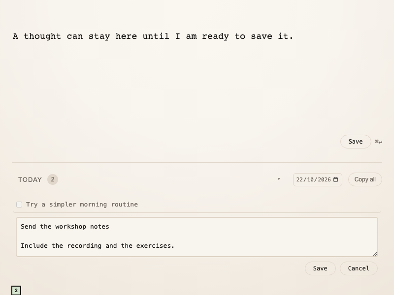

Inbox now keeps your draft when you switch apps or restart, and saves it to your daily journal when you press Save or ⌘Enter. Click a saved entry to edit it, with Save and Cancel controls, and use the date picker to revisit any day.

Get it: [Inbox 0.2.3](https://github.com/rufuspollock/inboxapp/releases/tag/v0.2.3).

